<div align="center">

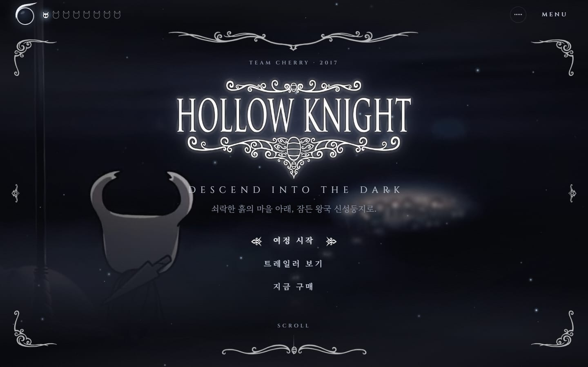

# HOLLOW KNIGHT — Remastered

**2020년, 처음 만든 jQuery 포트폴리오를 2026년의 도구로 처음부터 다시 지었습니다.**

신성둥지로 내려가는 시네마틱 팬메이드 랜딩페이지 · 할로우 나이트 & 실크송


</div>

---

## Before → After

| | 2020 (원본) | 2026 (리마스터) |
|---|---|---|
| 스택 | HTML + jQuery 3.4 + Bootstrap + FontAwesome(1.2 MB JS) | Astro 7 · TypeScript · GSAP · Lenis · Web Audio |
| 페이지 | 분할 인트로(`index.html`) + 풀페이지(`hollow.html`) | 하나의 시네마틱 스크롤 경험 |
| 미디어 | 저장소 73 MB, 14.5 MB 트레일러를 배경으로 자동재생 | 1.1 MB 히어로 루프(VP9) · 섹션별 지연 로딩 |
| 이미지 | 2 MB PNG 배경 그대로 | AVIF/WebP · 반응형 srcset · 1x/2x · AI 업스케일 |
| 사운드 | 자동재생 MP3(브라우저가 차단) | 입장 제스처로 여는 Web Audio 엔진 + 오리지널 SFX |
| 정보 | "실크송 2020년 봄 출시 예정" | 2025.09.04 출시 · Sea of Sorrow(2026) 반영 |
| 접근성 | alt 없음, div 클릭, 키보드 불가 | 탭 패턴 · 네이티브 dialog · 포커스 관리 · 모션 줄이기 |
| Lighthouse (데스크톱) | — | **Perf 97 · A11y 100 · BP 100 · SEO 100** |

<table>
  <tr>
    <td width="50%">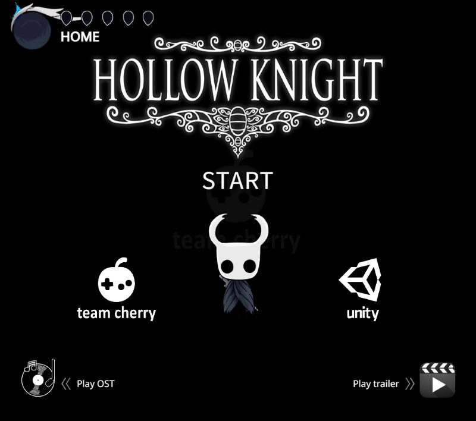<br><sub>2020 · 시작 화면</sub></td>
    <td width="50%">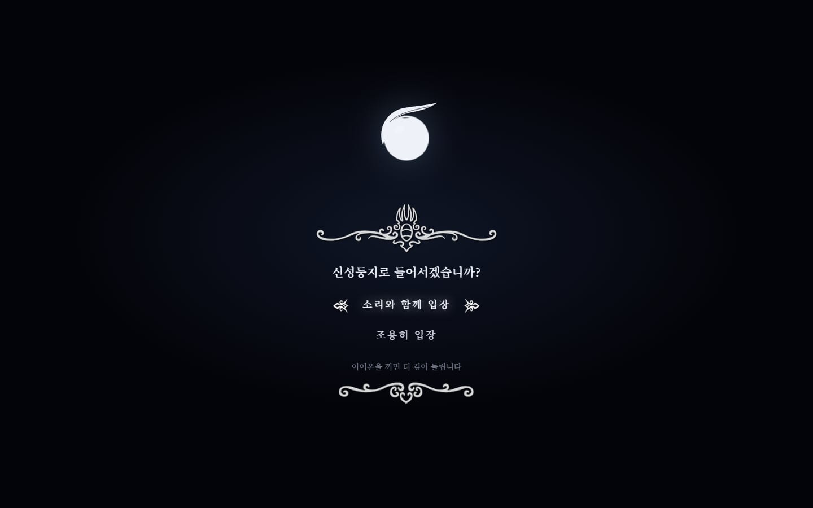<br><sub>2026 · 타이틀 게이트</sub></td>
  </tr>
  <tr>
    <td>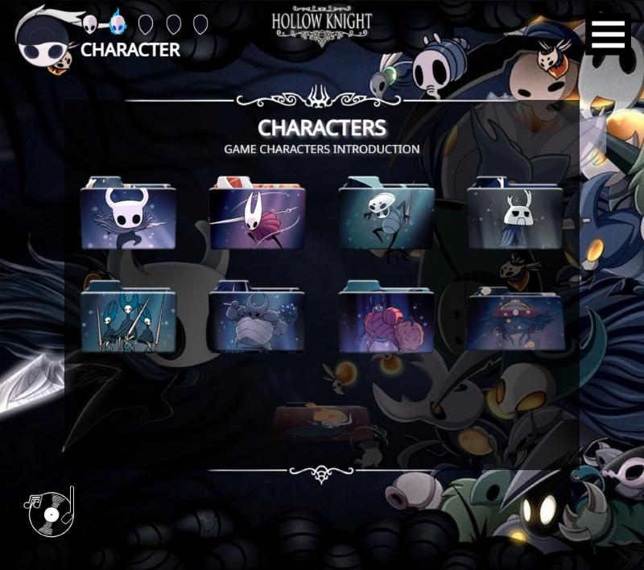<br><sub>2020 · 캐릭터 폴더 아이콘</sub></td>
    <td>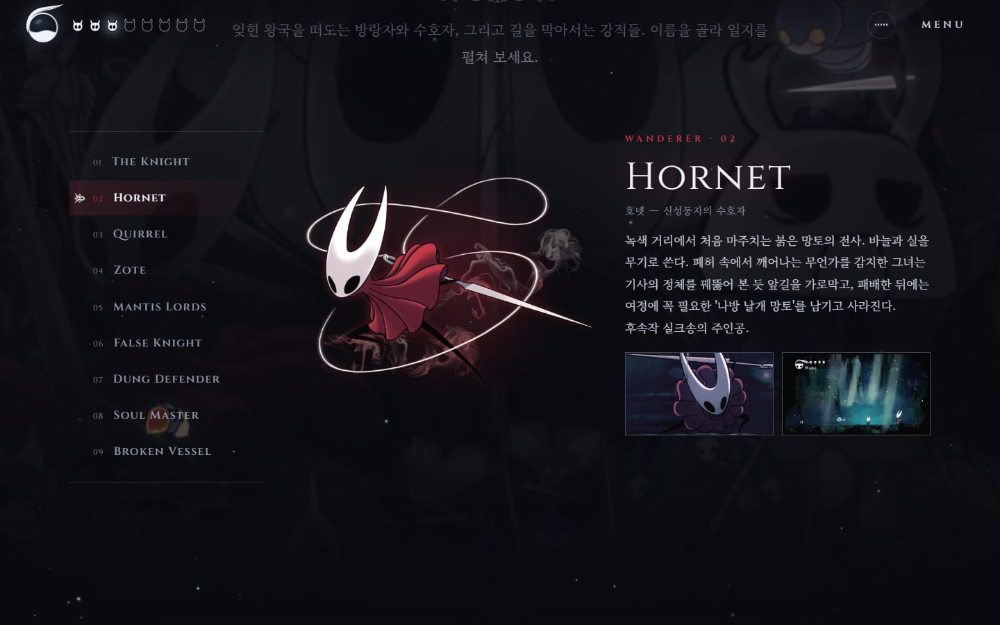<br><sub>2026 · 사냥꾼의 일지</sub></td>
  </tr>
</table>

원본 코드는 [`legacy/`](legacy)에 그대로 보존했습니다. `python -m http.server 5500 --directory legacy` 로 2020년 버전을 열어볼 수 있습니다.

---

## 무엇이 있나

| 섹션 | 내용 |
|---|---|
| **타이틀 게이트** | 소울 그릇이 로딩만큼 차오르고, *소리와 함께 / 조용히* 입장 — 브라우저 오디오 잠금을 푸는 사용자 제스처 |
| **HUD** | 게임 HUD 그대로: 소울 그릇 = 스크롤 진행도, 가면 8개 = 섹션 내비게이션(현재 섹션까지 채워짐) |
| **히어로** | 트레일러에서 로고·UI가 없는 프레임만 골라 만든 17.8초 루프, 원본 사이트의 장식 프레임을 조각내 비율 무관 배치, 숨 쉬는 소울 글로우 |
| **서막** | 섹션이 고정되고 스크롤에 맞춰 단어가 하나씩 밝아짐(GSAP SplitText + ScrollTrigger), 마지막 줄에서 소울 효과음 |
| **사냥꾼의 일지** | 9명의 캐릭터를 접근성 탭(←↑↓→ / Home / End)으로, 페이지 넘김 전환 · 2020년의 패럴랙스 벌레들 재사용 |
| **무료 확장팩** | 3D 틸트 + 글레어 카드, 공식 트레일러 다이얼로그(youtube-nocookie, 열릴 때만 iframe 생성) |
| **두 개의 여정** | 2020년 `index.html`의 분할 화면을 기사/호넷 패널로 재해석 |
| **실크송** | 출시 정보, HUD를 잘라낸 게임플레이 루프, 스크롤로 그려지는 실 · Sea of Sorrow 티저 |
| **사운드트랙** | 회전하는 레코드 + Web Audio 방사형 스펙트럼, Media Session(잠금화면 제어), HUD 미니 플레이어 |
| **예언자 (AI)** | Gemini가 연기하는 휴식의 땅의 예언자 — 한국어판 용어 사전·스포일러 경고·주제 이탈 거절 규칙 |
| **구매** | 공식 스토어 링크(전부 HTTP 200 + 페이지 제목으로 검증), 공식 굿즈 |

**공기도 섹션마다 다릅니다.** 화면 위를 떠다니는 입자는 섹션 테마(soul · void · dream · silk · gold)에 따라 색과 움직임이 바뀌고, 스크롤 속도와 포인터에 반응합니다. 실크송에 들어서면 불씨가 됩니다.

<table>
  <tr>
    <td width="50%">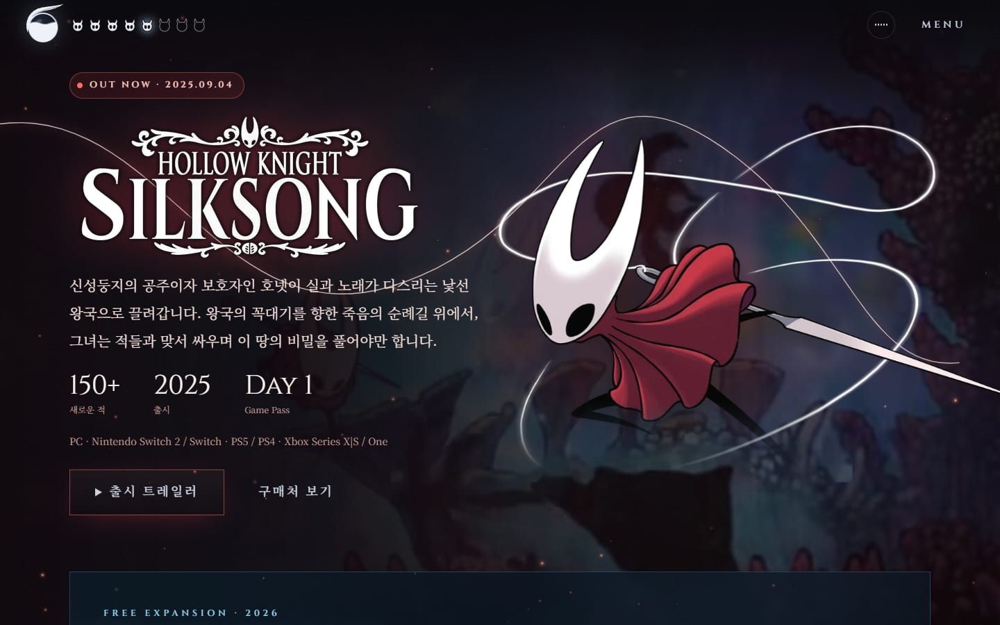</td>
    <td width="50%">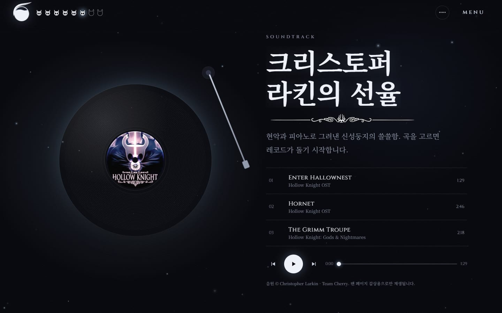</td>
  </tr>
  <tr>
    <td>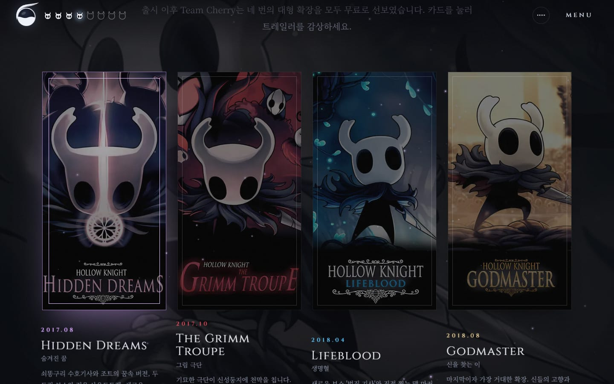</td>
    <td>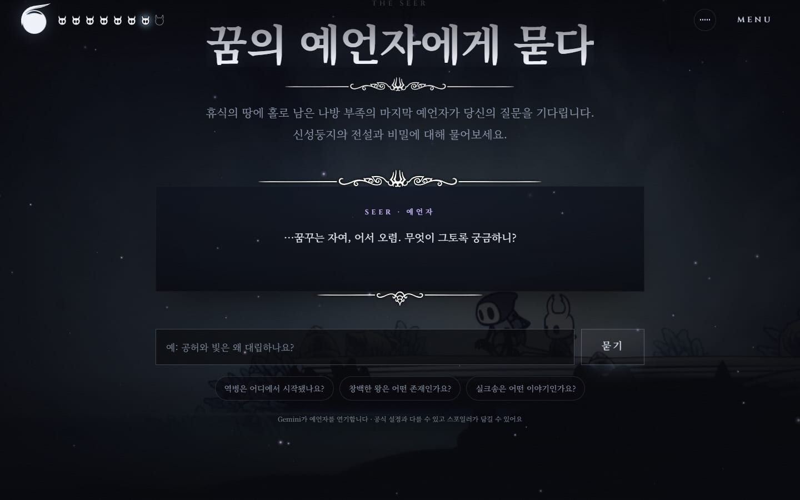</td>
  </tr>
</table>

<p align="center">
  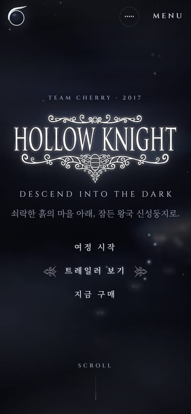
  &nbsp;
  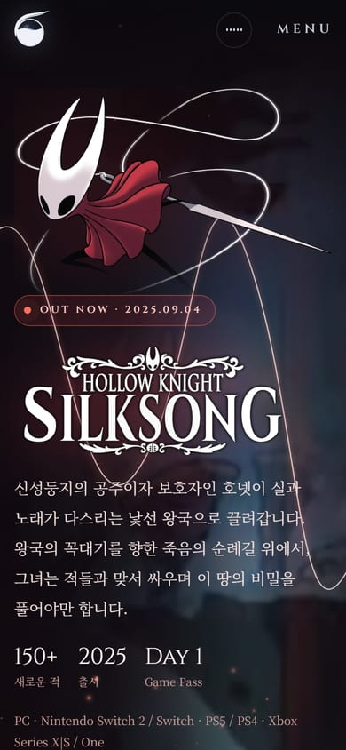
</p>

---

## AI · 미디어 파이프라인

에셋은 손으로 만지지 않고, 다시 돌릴 수 있는 스크립트로 만들었습니다.

| 스크립트 | 도구 | 하는 일 |
|---|---|---|
| `scripts/media.mjs` | FFmpeg | 트레일러 → CFR 중간본(원본 타임스탬프가 깨져 있어 프레임 정확도 확보) → 크로스페이드 몽타주 루프(H.264 + VP9, 모바일 480p), 실크송 HUD 크롭, GIF → 78 KB 비디오 |
| `scripts/images.mjs` | sharp | 레거시 이미지 75장을 의미 있는 이름으로 정리, 불투명 PNG → JPEG 소스, 1920×1080 투명 캔버스의 벌레 스프라이트를 잘라 좌표 기록 |
| `scripts/upscale.mjs` | **fal.ai** Real-ESRGAN | 300 px 스크린샷 4×, DLC 포스터 2×, 로고는 색과 알파를 따로 업스케일해 투명도 보존 |
| `scripts/sfx.mjs` | **ElevenLabs** Sound Generation | 호버·선택·메뉴·책장·바늘·입장·예언자·소울 효과음과 22초 동굴 앰비언스 생성 → FFmpeg로 라우드니스 정규화, 앰비언스는 끝을 앞에 크로스페이드해 끊김 없는 루프 |
| `scripts/og.mjs` | sharp | 소셜 카드(1200×630)와 기사 가면 아이콘(SVG → PNG) |
| `scripts/shots.mjs` | puppeteer-core | 이 README의 스크린샷 — 방문자처럼 게이트를 통과해 촬영 |
| `src/pages/api/seer.ts` | **Gemini 3.5 Flash Lite** | 예언자 엔드포인트(Vercel Function). 키는 서버에만, Origin 검사 · IP당 레이트 리밋 · 18초 타임아웃 · 키가 없으면 페이지가 정중히 "잠들어 있다"고 안내 |

---

## 구조

```
src/
├─ pages/
│  ├─ index.astro          # 섹션 조립
│  └─ api/seer.ts          # Gemini 예언자 (on-demand, 나머지는 전부 정적)
├─ components/             # Gate · Hud · Menu · Hero · Prologue · Journal · Expansions
│                          # Journeys · Silksong · Soundtrack · Seer · Purchase · Footer
├─ scripts/
│  ├─ app.ts               # 진입점 — 무거운 모듈은 idle/입장 시 동적 import
│  ├─ audio.ts             # Web Audio 엔진 (SFX 버스 · 앰비언스 덕킹 · 음악 버스)
│  ├─ motion.ts            # GSAP 연출 (SplitText · ScrollTrigger)
│  ├─ motes.ts             # 섹션 테마 입자 캔버스
│  ├─ player.ts / seer.ts / journal.ts / dialogs.ts / hud.ts / gate.ts / media.ts
├─ data/                   # 캐릭터 · 확장팩 · 트랙 · 스토어 — 콘텐츠는 데이터로
└─ styles/global.css       # 디자인 토큰 · HK 메뉴 버튼(장식 포인터) · 리빌 · 페일세이프
scripts/                   # 위 에셋 파이프라인
legacy/                    # 2020년 원본 그대로
```

**설계 메모**

- 페이지는 정적 HTML, 상호작용은 점진적 향상. JS가 없으면 게이트가 숨고 모든 콘텐츠가 그대로 보이며, 앱 스크립트가 실패해도 9초 뒤 CSS 페일세이프가 화면을 엽니다.
- `prefers-reduced-motion`(또는 메뉴의 *애니메이션* 토글)이면 Lenis·핀·입자·배경 영상이 꺼지고 포스터만 남습니다. 저데이터(`saveData`/2G)에서도 영상 대신 포스터.
- 게이트 뒤의 히어로는 로딩은 하되 칠하지 않아(LCP 오염 방지) 인트로로 처음 드러납니다.
- 한글 폰트는 Astro Fonts API로 자체 호스팅. Noto Serif KR 가변 폰트(400–700)라 유니코드 조각당 `@font-face` 하나 — HTML이 92 KB → 43 KB(gzip)로 줄었습니다.

---

## 시작하기

```bash
npm install
cp .env.example .env.local   # GEMINI_API_KEY (선택)
npm run dev                  # http://localhost:4321
```

| 명령 | |
|---|---|
| `npm run dev` | 개발 서버 |
| `npm run build` | `.vercel/output` 생성 (정적 페이지 + 예언자 함수) |
| `npm run preview` | 빌드 결과를 정적으로 띄워 보기(예언자 API 제외) |
| `npm run check` | 타입 검사 |
| `npm run assets` → `npm run assets:upscale` | 레거시 원본에서 영상·이미지 재생성 (순서 중요: images가 업스케일본을 덮어씀) |
| `npm run assets:sfx` | ElevenLabs로 효과음 재생성 (`ELEVENLABS_API_KEY`) |
| `npm run shots` | README 스크린샷 재촬영 (빌드를 4401 포트로 서빙한 상태에서) |

### 배포

같은 코드가 두 곳으로 나갑니다.

| 대상 | 명령 | 결과 |
|---|---|---|
| **GitHub Pages** — [tjsrjs8282.github.io/HollowKnight](https://tjsrjs8282.github.io/HollowKnight/) | `npm run build:pages` (`DEPLOY_TARGET=pages`) | `/HollowKnight` 아래 정적 파일. `master`에 푸시하면 `.github/workflows/pages.yml`이 빌드·배포. 예언자는 내장된 답변으로 응답 |
| **Vercel** | `npm run build` | 정적 페이지 + `/api/seer` 함수. 환경 변수 `GEMINI_API_KEY`를 넣으면 예언자가 깨어남. `vercel.json`이 미디어 캐시·보안 헤더 설정 |

모든 `public/` 경로는 `withBase()`(`src/lib/paths.ts`)를 거치므로 어느 쪽에서든 깨지지 않습니다.

---

## 2020 → 2026, 고친 것들

- **잘못된 콘텐츠**: 거짓 기사 설명이 기사 설명의 복붙이던 것, `SYSNOPSIS`·`MATIS LORDS`·`CONTNET`·`Hollow Kight` 오타, "Hornet"을 실크송 곡으로 표기하던 것, 2020년 봄 출시 예정이던 실크송.
- **팬 업로드 링크 교체**: Lifeblood(팬 업로드 OST)와 실크송 영상 2개(재업로드)를 Team Cherry 공식 영상으로 교체하거나 정리. 폐업한 스토어(Ghost Ramp) 제거, 남은 링크는 모두 실제 접속으로 검증.
- **동작**: 마우스 휠 하이재킹, 매 `mousemove`마다 리사이즈, 중복 `id`, 브라우저가 막는 자동재생, 높이 고정 레이아웃.
- **에셋**: 서드파티 워터마크가 찍힌 호넷 일러스트는 그림이 없는 모서리를 잘라 정리.

---

## 저작권

Hollow Knight, Hollow Knight: Silksong 및 이 프로젝트에 쓰인 모든 게임 이미지·영상·음악의 권리는 [Team Cherry](https://www.teamcherry.com.au/)와 각 저작권자(음악: Christopher Larkin)에게 있습니다. 이 저장소는 Team Cherry와 관계없는 **비영리 팬 프로젝트**입니다. 효과음(ElevenLabs 생성)과 코드는 이 프로젝트의 산출물입니다.
